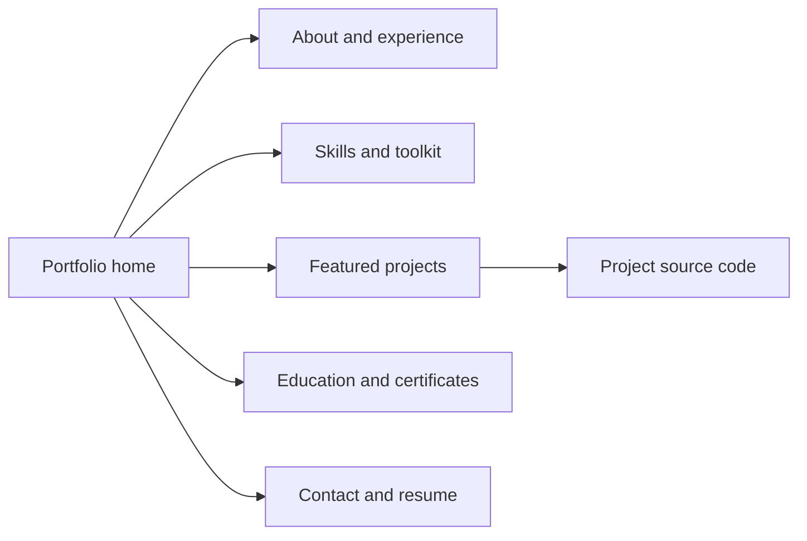
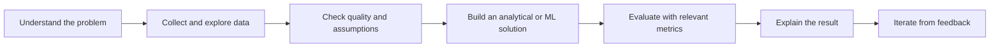

<div align="center">
  
  <h1>Ojaswa Srivastava</h1>
  <p><strong>Data Science · Analytics · Machine Learning · Generative AI</strong></p>
  <p>I turn data and ideas into practical, understandable tools.</p>
  <p>
    <a href="https://ojaswa05.github.io"></a>
    <a href="https://github.com/Ojaswa05"></a>
    <a href="https://www.linkedin.com/in/ojaswa-srivastava/"></a>
    <a href="mailto:ojaswasrivastava05192876@gmail.com"></a>
  </p>
</div>

---

## About me

I am an undergraduate Data Science student at **Ch. Devi Lal University**, interested in data analysis, machine learning, and building useful AI applications. I enjoy taking a problem from exploration through modeling and communicating the result clearly.

- **Currently exploring:** retrieval-augmented generation (RAG), LLM applications, and end-to-end machine-learning workflows.
- **Experience:** Data Science Intern at Developers Arena (October–November 2025).
- **Interested in:** relevant internships and early-career opportunities in data science, data analytics, machine learning, and AI engineering.
- **Portfolio:** [ojaswa05.github.io](https://ojaswa05.github.io)
- **Resume:** [View my resume](https://drive.google.com/file/d/1llalE6kc6J6HtpUA6T0OlMgKZ9rplPWf/view)

## Contents

- [Portfolio at a glance](#portfolio-at-a-glance)
- [Featured projects](#featured-projects)
- [Skills and tools](#skills-and-tools)
- [Experience and education](#experience-and-education)
- [Certificates](#certificates)
- [How I approach a project](#how-i-approach-a-project)
- [Run the portfolio locally](#run-the-portfolio-locally)
- [Deploy with GitHub Pages](#deploy-with-github-pages)
- [Repository structure](#repository-structure)
- [GitHub activity](#github-activity)
- [Get in touch](#get-in-touch)

## Portfolio at a glance

This repository contains my personal portfolio website. It introduces my background, highlights selected work, and makes it easy to explore my code, resume, and contact links.

| Area | What you will find |
| --- | --- |
| About | My interests, current focus, and working style |
| Experience | Internship and project-based experience |
| Skills | Data analysis, programming, machine learning, AI, and development tools |
| Projects | RAG knowledge assistant, stock-price prediction app, and ARIMA forecasting |
| Education | Undergraduate Data Science studies at Ch. Devi Lal University |
| Credentials | Selected cloud, generative AI, data science, and analytics certificates |
| Contact | Email, GitHub, LinkedIn, and resume |

The site is built with **HTML, CSS, and vanilla JavaScript**. It includes a responsive layout, mobile navigation, project and credential sections, reduced-motion support, scroll-based reveals, and a contact section.

### Visitor journey



## Featured projects

| Project | Overview | Tools | Source |
| --- | --- | --- | --- |
| **RAG-Based AI Knowledge Agent** | An intelligent tutoring assistant that retrieves relevant passages and timestamps from course lectures and notes, then uses an LLM to explain concepts using those materials. | Python, Whisper, Ollama, embeddings, FFmpeg | [View repository](https://github.com/Ojaswa05/RAG-Based-AI-Knowledge-Agent) |
| **Stock Price Prediction Web App** | A Streamlit application that uses historical AAPL prices, preprocessing, MinMax scaling, and an LSTM model to explore and forecast price trends. Forecasts are experimental and should not be treated as financial advice. | Python, Streamlit, TensorFlow/Keras, scikit-learn, yfinance | [View repository](https://github.com/Ojaswa05/Stock-Price-Prediction-Web-App) |
| **Time Series Forecasting Using ARIMA** | An analysis of hourly Italian electricity-demand and solar-generation data, exploring historical patterns and ARIMA forecasts. | Python, ARIMA, Statsmodels, data visualization | [View repository](https://github.com/Ojaswa05/Time-Series-Forecasting-using-ARIMA) |

Explore [all public repositories](https://github.com/Ojaswa05?tab=repositories) for additional data analysis, classification, and dashboard projects.

## Skills and tools

### Technology badges

<p>
  
  
  
  
  
  
  
  
  
  
  
  
</p>

| Focus | Skills and tools |
| --- | --- |
| **Data analysis** | Exploratory data analysis, data cleaning and preprocessing, data visualization, statistics, Excel |
| **Programming** | Python, R, SQL, PowerShell, Bash, front-end fundamentals |
| **Machine learning** | Supervised and unsupervised learning, feature engineering, model evaluation and tuning, TensorFlow/Keras |
| **Generative AI** | NLP, LLM applications, RAG pipelines, vector databases, prompt engineering, agentic AI |
| **Data and developer tools** | Pandas, NumPy, Matplotlib, scikit-learn, Jupyter, Git/GitHub, VS Code |
| **Platforms and storage** | Streamlit, FastAPI, MySQL, PostgreSQL, ChromaDB, Ollama, Docker; exposure to Google Cloud, AWS, Azure, and Oracle Cloud |

## Experience and education

### Data Science Intern — Developers Arena
**October 10 – November 10, 2025**

- Explored datasets of more than one million records to identify trends and outliers.
- Built and optimized predictive models, including Random Forest and XGBoost.
- Documented data workflows and model architecture.
- Communicated analysis through Power BI and Tableau dashboards.

### Undergraduate studies in Data Science — Ch. Devi Lal University

Currently pursuing an undergraduate degree in Data Science. The portfolio lists a **9/10 CGPA**.

## Certificates

Selected credentials listed on the portfolio:

| Certificate | Provider | Credential |
| --- | --- | --- |
| Oracle Cloud Database Certified Professional 2025 | Oracle | [View certificate](https://drive.google.com/file/d/1yNzCqpFrWW18cpSF4EPpLncsbwfcuITw/view?usp=sharing) |
| Introduction to Generative AI | AWS | [View certificate](https://drive.google.com/file/d/1GdiD4L5H4UFq1Y-5bIVHZQ8rZXLSsMeH/view?usp=sharing) |
| Introduction to Azure Fundamentals | Microsoft Azure | [View certificate](https://drive.google.com/file/d/1HcXwRYIK7ikpyMcs0Dsd-GpdKh5xzxyt/view?usp=sharing) |
| Data Science Course | CWH | [View certificate](https://drive.google.com/file/d/14SK2DHIfPRw6g4TmuhBk0xPIvIJcBsqk/view?usp=sharing) |
| Introduction to Data Analytics | Deloitte | [View certificate](https://drive.google.com/file/d/1P2n_9qQHFbAOgAVSd-LhnkIdgxCNg877/view?usp=sharing) |

## How I approach a project



I start by clarifying the goal and what a useful outcome looks like. I then inspect the data and assumptions before selecting an approach, evaluating it with relevant measures, and communicating findings in a way people can use.

## Run the portfolio locally

The site is static and has no package installation or build step.

1. Clone or download this repository.
2. From the project directory, start a local web server:

   ```bash
   python -m http.server 8000
   ```

3. Open [http://localhost:8000](http://localhost:8000) in your browser.

You can also open `index.html` directly, but a local server is recommended for a browser-like preview.

## Deploy with GitHub Pages

This site is intended for the GitHub Pages repository [`Ojaswa05.github.io`](https://github.com/Ojaswa05/Ojaswa05.github.io).

1. Push the site files to the repository's `main` branch, keeping `index.html` at the published root.
2. In **Settings → Pages**, choose **Deploy from a branch**, select `main` and the root (`/`) folder, and save.
3. Once GitHub Pages finishes publishing, visit [https://ojaswa05.github.io](https://ojaswa05.github.io).

## Repository structure

```text
.
├── index.html   # Portfolio content and page structure
├── style.css    # Layout, responsive styling, and visual design
├── script.js    # Navigation, interactions, and animations
├── image.jpeg   # Portfolio portrait and social preview image
└── README.md    # Project overview and setup guide
```

## GitHub activity

These charts are generated from public GitHub profile data and may take a moment to load:

<div align="center">
  
  
  <br />
  
</div>

## Get in touch

- **Email:** [ojaswasrivastava05192876@gmail.com](mailto:ojaswasrivastava05192876@gmail.com)
- **LinkedIn:** [linkedin.com/in/ojaswa-srivastava](https://www.linkedin.com/in/ojaswa-srivastava/)
- **GitHub:** [github.com/Ojaswa05](https://github.com/Ojaswa05)
- **Portfolio:** [ojaswa05.github.io](https://ojaswa05.github.io)

---

<div align="center">
  <sub>Designed and built with curiosity by Ojaswa Srivastava.</sub>
</div>
